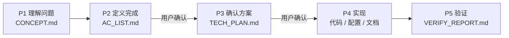

<div align="center">

# Butler

**面向 AI 工程协作的验收导向 SOP**

让 AI 先理解目标、明确验收、确认方案，再实现并拿证据交付。


</div>

Butler 是一套 Markdown 规则和配套工具，不是代码框架。它把 AI 开发过程沉淀到项目内的 `.ai/`：需求怎么理解、什么算完成、准备怎么改、验证结果如何，都有明确文件可查，不再依赖一段容易丢失的对话。

## 它解决什么问题

- **避免没对齐就写代码**：标准流程在实现前先确认验收标准和技术方案。
- **让长任务可以接着做**：迭代状态、阶段产物和交接信息都落在项目里，新会话能恢复现场。
- **让“做完了”有证据**：验证记录必须对应验收项，失败、弱验证和待人工确认的部分如实保留。
- **让流程约束真正生效**：部署后的 Hook 会在关键产物缺失或未通过门禁时阻止源码写入。

## 工作方式

每个非极小任务默认走一轮 `P1 → P5`：



| 阶段 | 回答的问题 | 主要产物 |
|---|---|---|
| P1 Analysis | 我们到底要解决什么？ | `.ai/CONCEPT.md` |
| P2 Acceptance | 什么结果才算完成？ | `.ai/AC_LIST.md` |
| P3 Design | 准备怎么改，风险在哪里？ | `.ai/TECH_PLAN.md` |
| P4 Execute | 按已确认范围完成实现 | 代码、配置或文档 |
| P5 Verify | 验收项是否有证据证明？ | `.ai/VERIFY_REPORT.md` |

一轮 P1–P5 是一个可独立交付的**迭代**（`ITER-NNNN`）。需要多个迭代共同完成的大版本，可以再用可选的**里程碑**（`MILE-NNNN`）组织；只有真正开工时才编号，讨论中的方向先放候办区。

## 快速开始

### 1. 安装机器级能力

首次使用时，在已经克隆的 Butler 仓库中运行：

```bash
bash scripts/setup.sh
```

安装脚本会配置 `BUTLER_PATH`，并安装或刷新 Claude Code 命令、Codex plugin 与 Pi 扩展。它只处理本机能力，不会初始化当前业务项目。

### 2. 接入项目

在目标项目中开启新的 AI 会话，然后使用对应入口：

| 宿主 | 显式入口 |
|---|---|
| Claude Code | `/butler:init` |
| Codex | `$butler-init` |
| Pi | 直接说“用 Butler 初始化当前项目” |

也可以直接给任务并点名项目路径。AI 发现目标项目尚无 `.ai/` 时，会按同一协议完成初始化；如果所在目录包含多个项目，它会先要求你明确目标，不会猜测施工位置。

### 3. 正常描述任务

```text
在 /path/to/project 实现登录失败后的账号锁定，并补齐验证。
```

Butler 会根据任务规模选择简化或完整流程。完整流程中，你主要在 P2 确认“什么算完成”，在 P3 确认“准备怎么做”；实现和验证完成后，会得到迭代归档以及 Markdown、HTML 两种交付总结。

已有 Butler 项目需要同步到当前版本时，使用 `/butler:upgrade`（Claude Code）或 `$butler-upgrade`（Codex）。升级会先给出零写入计划，确认后才事务执行。

## 你会在项目里得到什么

```text
project/
├── CLAUDE.md / AGENTS.md       # Claude Code / Codex 项目入口
├── .ai/
│   ├── CONCEPT.md              # 当前迭代的问题理解
│   ├── AC_LIST.md              # 冻结后的验收标准
│   ├── TECH_PLAN.md            # 通过准入的技术方案
│   ├── VERIFY_REPORT.md        # 验证结果与剩余风险
│   ├── ITERATIONS.md           # 迭代台账
│   ├── task-state.md           # 当前运行状态
│   ├── project/                # 项目长期知识
│   └── iterations/             # 已收口迭代快照
├── deliveries/                 # 给人阅读的 .md / .html 交付总结
└── origin/                     # 可选的原始需求收件箱，AI 只读
```

完整布局、旁路 Agent 回执、PRD 管理和版本升级说明见 [使用指南](HUMAN_GUIDE.md)。

## 常用入口

命令只是明确入口；普通场景也可以直接用自然语言表达。高风险能力不会被隐式开启。

| 场景 | Claude Code | Codex |
|---|---|---|
| 初始化项目 | `/butler:init` | `$butler-init` |
| 梳理还没想清的需求 | `/butler:ideation` | `$butler-ideation` |
| 规划多迭代版本或候办方向 | `/butler:milestone` | `$butler-milestone` |
| 处理需求收件箱 | `/butler:inbox` | `$butler-inbox` |
| 切分、查询或更新 PRD | `/butler:prd` | `$butler-prd` |
| 查看当前进度 | `/butler:progress` | `$butler-progress` |
| 复核代码或阶段产物 | `/butler:review` | `$butler-review` |
| 升级已接入项目 | `/butler:upgrade` | `$butler-upgrade` |
| 刷新本机 Butler 能力 | `/butler:setup` | `$butler-setup` |

`/butler:loop` / `$butler-loop` 是显式开启的高强度纠错；`/butler:dangerous` / `$butler-dangerous` 是显式开启的无人值守自治。两者相互独立，也都不会因为普通任务自动启用。完整命令、触发条件和兼容旧名以机器注册表生成的 [工作流清单](docs/workflows.md) 为准。

## 三宿主如何共享同一套规则

| 宿主 | 项目发现入口 | 适配方式 |
|---|---|---|
| Claude Code | `CLAUDE.md` | `/butler:*` 命令与 Python Hooks |
| Codex | `AGENTS.md` | `plugins/butler/` skills 与 Python Hooks |
| Pi | `AGENTS.md` | `plugins/butler-pi/` TypeScript 扩展 |

规则算法只维护在 `Coder/`，宿主入口只负责发现和适配，不各自复制一套流程。Hook 是流程门禁，不是操作系统 sandbox；首次启用时仍应审阅并确认信任。双宿主边界和验证矩阵见 [Codex 兼容说明](docs/codex-compatibility.md)。

## 仓库结构

```text
butler/
├── Coder/                  # P1–P5、质量门禁、上下文与扩展规则真源
├── plugins/                # Codex plugin 与 Pi 适配器
├── templates/              # 项目入口、Hook、交付等模板
├── tools/                  # 升级、证据、Goal、handoff 等驻留工具
├── scripts/                # 安装、生成、审计和完整验证入口
├── workflows/              # 双宿主工作流机器注册表
├── migrations/             # 已部署项目的版本迁移配方
├── docs/                   # 兼容边界和专项说明
└── deliveries/             # Butler 自身的迭代与里程碑交付历史
```

规则分层、读取顺序和文件职责从 [Coder/README.md](Coder/README.md) 开始。人类操作说明从 [HUMAN_GUIDE.md](HUMAN_GUIDE.md) 开始。

## 维护与验证

修改 Butler 本身后，运行与 CI 相同的完整入口：

```bash
bash scripts/verify-ci.sh
```

CI 会验证规则投影、Claude/Codex/Pi 适配、Hooks、状态与产物审计、Markdown 链接和各驻留工具。GitHub 上最终汇总检查名为 `Butler required checks`；是否设为分支必需检查仍需仓库管理员在 Ruleset 或 Branch protection 中配置。

长期运行项目如果需要迁移大体量 ITER/MILE 台账，再使用 [`tools/state-ledger/`](tools/state-ledger/) 的 `inspect → migrate → check` 流程；它是维护工具，不是首次使用步骤。

## 继续阅读

- [HUMAN_GUIDE.md](HUMAN_GUIDE.md)：安装、项目接入和日常使用
- [Coder/README.md](Coder/README.md)：规则体系入口与读取顺序
- [docs/workflows.md](docs/workflows.md)：全部 Claude Code / Codex 工作流入口
- [docs/codex-compatibility.md](docs/codex-compatibility.md)：双宿主边界与兼容矩阵
- [CHANGELOG.md](CHANGELOG.md)：版本发布历史
