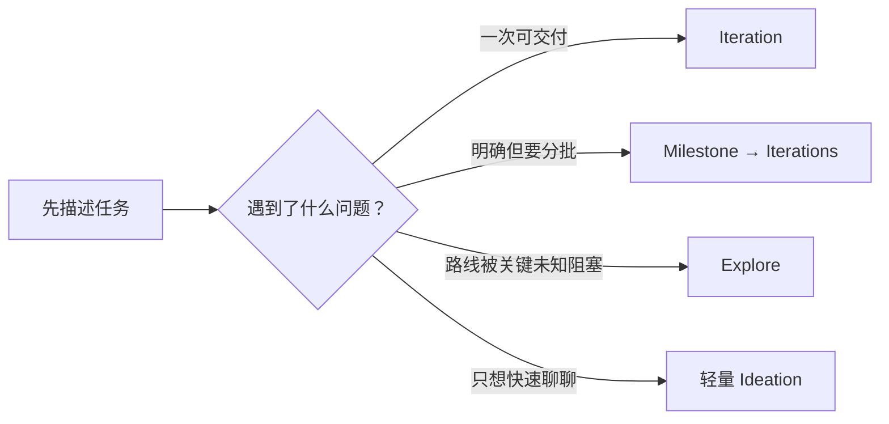
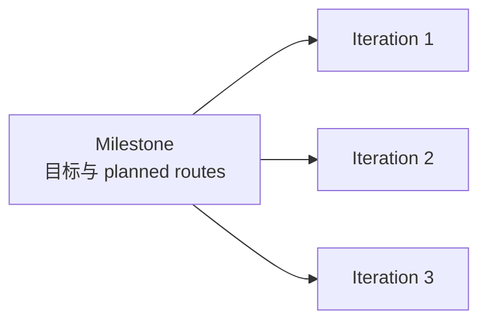
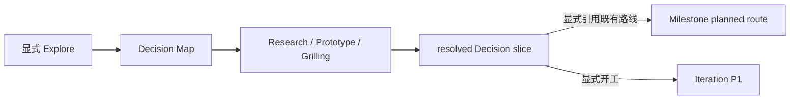

<div align="center">

# Butler

**面向 AI 工程协作的验收导向 SOP**

让 AI 先理解目标、明确验收、确认方案，再实现并拿证据交付。

[](https://github.com/hidetodong/butler/actions/workflows/ci.yml)
[](CHANGELOG.md)
[](LICENSE)
[](#三宿主如何共享同一套规则)

</div>

Butler 是一套 Markdown 规则和配套工具，不是代码框架。它把 AI 开发过程沉淀到项目内的 `.ai/`：需求怎么理解、什么算完成、准备怎么改、验证结果如何，都有明确文件可查，不再依赖一段容易丢失的对话。

## 它解决什么问题

- **避免没对齐就写代码**：标准流程在实现前先确认验收标准和技术方案。
- **让长任务可以接着做**：迭代状态、阶段产物和交接信息都落在项目里，新会话能恢复现场。
- **让“做完了”有证据**：验证记录必须对应验收项，失败、弱验证和待人工确认的部分如实保留。
- **让流程约束真正生效**：部署后的 Hook 会在关键产物缺失或未通过门禁时阻止源码写入。

Butler 采用渐进式使用：**先只学会完成一个普通任务，遇到多次交付时再用 Milestone，遇到阻塞决策时才进入 Explore。** 这些层级是按需增加的能力，不是每个需求都必须依次走过的前置流程。

## 目录

- [快速开始](#快速开始)
- [第一级：完成一个普通任务](#第一级完成一个普通任务)
- [什么时候需要增加一层能力](#什么时候需要增加一层能力)
- [不同层级的 Token 开销预估](#不同层级的-token-开销预估)
- [第二级：用 Milestone 组织多次交付](#第二级用-milestone-组织多次交付)
- [第三级：用 Explore 解决阻塞决策](#第三级用-explore-解决阻塞决策)
- [其他能力按问题启用](#其他能力按问题启用)
- [项目里会留下什么](#项目里会留下什么)
- [三宿主如何共享同一套规则](#三宿主如何共享同一套规则)
- [维护者入口](#维护者入口)
- [继续阅读](#继续阅读)
- [支持与维护](#支持与维护)
- [参与贡献](#参与贡献)
- [安全](#安全)
- [许可证](#许可证)

## 快速开始

第一次使用只需要完成四步，不必先理解 Milestone、Explore 或内部状态机。

### 1. 准备环境

需要 Git、Bash、Python 3，以及 Claude Code、Codex 或 Pi 中至少一个宿主。未安装的宿主会被跳过。

Butler 当前在 macOS 14 和 Ubuntu 24.04 上通过 CI 验证；Windows 原生环境尚未纳入验证矩阵。

### 2. 安装 Butler

```bash
git clone https://github.com/hidetodong/butler.git
cd butler
bash scripts/setup.sh
```

安装器会：

- 在现有 `~/.zshrc` 或 `~/.bashrc` 中写入 `BUTLER_PATH`；两者都不存在时提示手动配置。
- 更新 `~/.claude/CLAUDE.md` 并维护 Butler 命令软链。
- 检测到 Codex CLI 时安装或刷新 Butler plugin。
- 检测到 Pi CLI 时安装 Butler 扩展。

它只安装机器级能力，不会初始化业务项目。安装器会先检查冲突，再以可重复运行的方式更新已认领内容；首次启用 Hook 或 plugin 时仍应审阅并确认信任。完整写入边界和故障处理见 [使用指南](HUMAN_GUIDE.md#3-安装一次性)。

安装后重启终端，或重新加载 shell 配置：

```bash
source ~/.zshrc  # 使用 Bash 时改为 source ~/.bashrc
test -n "$BUTLER_PATH" && test -f "$BUTLER_PATH/Coder/README.md" && echo "Butler ready"
```

看到 `Butler ready` 后，为对应宿主新开一个会话。

### 3. 接入项目

在目标项目的新会话中使用对应入口：

| 宿主 | 显式入口 |
|---|---|
| Claude Code | `/butler:init` |
| Codex | `$butler-init` |
| Pi | 直接说“用 Butler 初始化当前项目” |

也可以直接给出任务并点名项目路径。AI 发现项目尚无 `.ai/` 时，会按同一协议完成初始化；如果当前目录包含多个项目，它会要求你明确目标，不会猜测施工位置。

### 4. 给出第一个任务

```text
在 /path/to/project 实现登录失败后的账号锁定，并补齐验证。
```

到这里已经足够开始日常使用。普通任务默认进入 Iteration；你无需先选择其他模式，也无需判断需求属于哪一种规模。

已有 Butler 项目需要同步到当前版本时，使用 `/butler:upgrade`（Claude Code）或 `$butler-upgrade`（Codex）。升级会先给出零写入计划，确认后才事务执行。

## 第一级：完成一个普通任务

一个可独立交付的任务对应一轮 Iteration。非极小任务按 `P1 → P5` 推进：


| 阶段 | 回答的问题 | 主要产物 |
|---|---|---|
| P1 Analysis | 我们到底要解决什么？ | `.ai/CONCEPT.md` |
| P2 Acceptance | 什么结果才算完成？ | `.ai/AC_LIST.md` |
| P3 Design | 准备怎么改，风险在哪里？ | `.ai/TECH_PLAN.md` |
| P4 Execute | 按已确认范围完成实现 | 代码、配置或文档 |
| P5 Verify | 验收项是否有证据证明？ | `.ai/VERIFY_REPORT.md` |

你主要需要做两次判断：

1. 在 P2 确认“这些验收标准是否真的代表完成”。
2. 在 P3 确认“方案、范围和风险是否可以接受”。

之后 Butler 实现、验证并收口：冻结产物进入 `.ai/iterations/ITER-NNNN/`，同时在 `deliveries/` 生成 Markdown、HTML 两种交付总结。新会话恢复时读的是这些项目状态与证据，而不是猜测上一段对话。

极小、低风险的改动可以按既有规则简化，但普通任务仍从同一个入口开始，不需要用户预先分类。

## 什么时候需要增加一层能力

先看你遇到的具体问题，不要让模型只凭“看起来很大”或“似乎不清晰”自动决定路线。

| 当前情况 | 使用方式 |
|---|---|
| 目标和下一步明确，一次可以交付 | 保持第一级，直接开始 Iteration |
| 目标明确，但需要多个 Iteration 分批交付 | 增加 Milestone |
| 存在会阻塞路线的未知项，需要跨会话求证、比较或并行探索 | 显式选择 Explore |
| 只是想快速聊想法 | 使用轻量 Ideation，不建立 Decision Map |



这里没有一个必须由模型猜测的“大小 × 清晰度”分类器。默认保持简单路线；增加能力需要可说清的现实原因。

## 不同层级的 Token 开销预估

这里估算的是 **Butler 自身占用的上下文窗口**，不是完成工作的总 Token：只计算项目入口、Butler 规则、工作流 Skill、Schema 和内部工具合同；不计算用户需求、业务代码、项目知识、对话正文、工具输出、验证日志、Research / Prototype 结果或模型的实现推理。

下表基于 Butler v3.5.1 文件测量，用 `o200k_base` 与 `cl100k_base` 两种 tokenizer 测量后取整；v3.6.0 用同一渲染器复测常驻入口，体量比 v3.5.1 略低约 4%（新增 L0 渐进读取纪律，但同期删减多于新增），因此各行区间沿用不变。不同宿主和模型的 tokenizer、prompt cache 与 Skill 注入方式不同，因此它是**静态协议体量的估算**，不是 API 账单或硬上限。

| 当前使用方式 | Butler 上下文总占用 | 相对常驻入口的按需增量 | 主要加载内容 |
|---|---:|---:|---|
| 常驻入口 / 极小任务 | 约 4.5k–5.7k | — | 生成后的 `CLAUDE.md` / `AGENTS.md` 与内联规则卡 |
| 轻量 Ideation | 约 6.8k–8.8k | 约 2.4k–3.2k | Ideation Skill 与 `ideation-engine` |
| Milestone 规划 | 约 14k–18k | 约 9.5k–12k | Milestone Skill 与 `milestone-schema` |
| 持久化 Explore | 约 13k–16k | 约 8k–10k | Ideation、Decision Map / Work / Promotion 合同 |
| Iteration 当前阶段 | 约 5.4k–9.1k | 约 0.9k–3.4k | 常驻入口加当前 P1 / P2 / P3 / P5 Schema，按阶段只读一份 |
| 同一会话走完 P1–P5 | 约 12k–15k | 约 7.8k–9.5k | 四阶段 Schema 已在同一上下文中累计保留 |
| P1–P5 加完整实现/测试细则 | 约 16k–20k | 约 12k–14.5k | 仅在确需细节时再加载 implementation / testing 规则 |
| 通用 Router（仅未点名入口时） | 在当前方式上再加约 6.2k–6.5k | 约 6.2k–6.5k | Router Skill、路由规则与 workflow registry |

这些数字需要按以下方式理解：

- **每行是当前会话的总占用，不是逐层相加。** Milestone 和 Explore 是不同的按需工作上下文，不要求同时把所有规则塞进一个会话。
- **层级越高不代表协议一定越大。** 渐进式层级表示何时需要某种能力；持久化 Explore 的规则体量仍可能小于完整 P1–P5。
- **Promotion 后按交付上下文计算。** Explore 接入 Iteration 后，后续会话主要加载 Iteration 规则；只要遵守触发式读取，就不必永久携带整套 Explore 合同。
- **20k 不是常规 Iteration 起步价。** 只有同一会话保留全部阶段 Schema，并进一步深读实现与测试细则时才接近 20k；正常阶段工作约为 5.4k–9.1k。
- **三份核心规则不是每次必读。** 把 `logic-protocol + lifecycle + iteration-schema` 全文同时读入会达到约 19k–24k，但项目入口把它们定义为“需要查阅完整细节时”才读取的参考路径，不是标准冷启动动作。
- **触发式读取目前是协议约束，不是机械上下文 loader。** 上述常规区间假设 Agent 遵守读取边界；如果模型主动把所有深度规则全文读入，仍可能出现 20k 以上的过度加载。
- **跨会话会重复常驻入口，但不会无限累加占用。** 每个新会话重新承担约 4.5k–5.7k 的基础上下文；累计计费是否因 prompt cache 降低由宿主决定。
- **显式入口能省掉 Router 上下文。** 已知道要用 Milestone 或 Explore 时，直接使用对应命令 / Skill，避免再加载通用路由表。

因此，控制 Butler 自身开销的关键不是压缩业务工作，而是保持规则触发式加载：当前阶段只读当前 Schema，普通任务不预读 Milestone / Explore，轻量 Ideation 不建立 Decision Map，Explore promotion 后让 Decision Map 降为引用，不把所有历史规则和状态全文带进后续会话。

这组数据也暴露了真正值得优化的地方：即使极小任务，常驻规则卡仍占约 4.5k–5.7k。若要继续降低 Butler 的固定成本，优先目标应是压缩或分层注入规则卡，而不是把正常 Iteration 描述成必须预加载 20k 规则。

## 第二级：用 Milestone 组织多次交付

当目标已经明确，只是内容需要分批完成时，直接建立 Milestone。它负责维护多次交付的路线；每次具体施工仍由独立 Iteration 完成。

```text
这个版本需要分三批完成。先建立 Milestone，列出 planned routes，
然后只启动第一条路线的 Iteration。
```



| 概念 | 负责什么 | 不负责什么 |
|---|---|---|
| Milestone | 版本目标、planned routes、跨迭代进度 | 单次实现细节与 P1–P5 证据 |
| Iteration | 一次可独立验收的交付 | 整个版本的长期路线 |
| Backlog | 尚未开工的方向 | 占用正式 MILE 编号 |

只有真正开始组织交付时才领取 `MILE-NNNN`；讨论中的方向先留在候办区。使用 `/butler:milestone`（Claude Code）或 `$butler-milestone`（Codex）建立、查看、拆分或延后里程碑。

**目标明确但内容很多，不需要先走 Explore。** Milestone 已经能处理“一次做不完”的问题。

## 第三级：用 Explore 解决阻塞决策

Explore 不是更大型的 Iteration，也不是所有需求的前置阶段。只有关键未知已经阻塞路线，而且探索需要跨会话保存、受控求证或并行工作时，才值得增加这一层。

Explore 复用现有 Ideation 入口，没有新增用户入口：

| 宿主 | 入口 |
|---|---|
| Claude Code | `/butler:ideation` |
| Codex | `$butler-ideation` |
| Pi | 直接说“用 Explore 帮我梳理这个方向，先不要开 Iteration” |

### 先区分轻量 Ideation 与 Explore

| 模式 | 适合什么 | 是否持久化 Decision Map |
|---|---|---|
| 轻量 Ideation | 快速脑暴、比较几个想法、随时结束 | 否 |
| Explore | 阻塞决策要跨会话处理，或需要 Research / Prototype / Grilling | 是，必须由用户显式选择或接受具体建议 |

模型可以指出一个具体 blocker 并建议 Explore，但不能仅凭“需求很大”“还不够清晰”自动开启。

### 开始和继续

```text
用 Explore 帮我梳理离线同步方案。把会阻塞路线的决策和证据保存下来，
可以做 Research 或 Prototype，但先不要建立 Milestone，也不要开 Iteration。
```

跨会话继续时：

```text
继续当前 Decision Map，先告诉我 Frontier 和下一步。
```

Butler 会恢复 Decision、依赖、证据和当前可处理项，不重新猜测上次讨论。

### Explore 如何回到交付



Decision Map 只记录“为什么这样选”的理由、证据和历史，不是交付计划。交接时必须由用户明确指定已解决的 Decision slice 和目标。

只接到既有 Milestone 路线：

```text
把 DMAP-0001 中已经解决的离线冲突策略作为参考，
接到 MILE-0015 的 planned route；先不要启动 Iteration。
```

直接开始一次交付：

```text
用 DMAP-0001 已解决的 D-003 作为输入，启动一个 Iteration；从 P1 开始。
```

固定边界如下：

- Explore 不替代 Milestone 的多迭代路线管理。
- Promotion 只做显式交接，不创建隐含路线。
- 进入 Iteration 时仍从 P1 开始，不跳过验收或方案确认。
- 交接后 Decision Map 是可追溯的参考来源，不成为第四个执行真源。

## 其他能力按问题启用

日常使用不需要记住全部命令。遇到对应问题时再启用：

| 遇到的问题 | 能力 | Claude Code / Codex 入口 |
|---|---|---|
| 原始需求来自多处，需要先扫描和分类 | 需求收件箱 | `/butler:inbox` · `$butler-inbox` |
| 一份产品文档需要拆成可独立版本化的需求 | PRD 管理 | `/butler:prd` · `$butler-prd` |
| 想看当前 Milestone、Iteration、验收和风险 | 进度总览 | `/butler:progress` · `$butler-progress` |
| 需要复核代码、方案或验收覆盖 | Review | `/butler:review` · `$butler-review` |
| 另一个 Agent 已完成旁路工作，需要接回主线 | Sidework receipt | 提供 `.ai/sidework/` 回执路径 |
| 希望在明确同意后学习真人取舍 | 偏好学习 | `/butler:preference` · `$butler-preference` |
| 常规纠错不足，需要有上限的持续探测和修正 | Loop | `/butler:loop` · `$butler-loop` |
| 明确接受更高自治和风险，希望无人值守推进 | Dangerous | `/butler:dangerous` · `$butler-dangerous` |

Loop 与 Dangerous 都必须显式开启，彼此独立，也不会因普通任务自动启用。全部入口、触发条件和兼容旧名见机器注册表生成的 [工作流清单](docs/workflows.md)。

## 项目里会留下什么

理解这些文件不是开始使用的前提；当你需要恢复会话、检查证据或排查流程时再查看：

```text
project/
├── CLAUDE.md / AGENTS.md       # Claude Code / Codex 项目入口
├── .ai/
│   ├── CONCEPT.md              # 当前迭代的问题理解
│   ├── AC_LIST.md              # 冻结后的验收标准
│   ├── TECH_PLAN.md            # 通过准入的技术方案
│   ├── VERIFY_REPORT.md        # 验证结果与剩余风险
│   ├── ITERATIONS.md           # 迭代台账
│   ├── task-state.md           # 当前运行状态
│   ├── project/                # 项目长期知识
│   └── iterations/             # 已收口迭代快照
├── deliveries/                 # 给人阅读的 .md / .html 交付总结
└── origin/                     # 可选的原始需求收件箱，AI 只读
```

完整布局、旁路 Agent 回执、PRD 管理和版本升级说明见 [使用指南](HUMAN_GUIDE.md)。

## 三宿主如何共享同一套规则

| 宿主 | 项目发现入口 | 适配方式 |
|---|---|---|
| Claude Code | `CLAUDE.md` | `/butler:*` 命令与 Python Hooks |
| Codex | `AGENTS.md` | `plugins/butler/` skills 与 Python Hooks |
| Pi | `AGENTS.md` | `plugins/butler-pi/` TypeScript 扩展 |

规则算法只维护在 `Coder/`，宿主入口只负责发现和适配，不各自复制一套流程。Hook 是流程门禁，不是操作系统 sandbox；首次启用时仍应审阅并确认信任。双宿主边界和验证矩阵见 [Codex 兼容说明](docs/codex-compatibility.md)。

## 维护者入口

普通用户可以在上一节结束阅读。下面是修改 Butler 本身时才需要的仓库结构与内部工具。

```text
butler/
├── Coder/                  # P1–P5、质量门禁、上下文与扩展规则真源
├── plugins/                # Codex plugin 与 Pi 适配器
├── templates/              # 项目入口、Hook、交付等模板
├── tools/                  # 升级、证据、Goal、handoff 等驻留工具
├── scripts/                # 安装、生成、审计和完整验证入口
├── workflows/              # 双宿主工作流机器注册表
├── migrations/             # 已部署项目的版本迁移配方
├── docs/                   # 兼容边界和专项说明
└── deliveries/             # Butler 自身的迭代与里程碑交付历史
```

修改 Butler 后运行与 CI 相同的完整入口：

```bash
bash scripts/verify-ci.sh
```

CI 会验证规则投影、Claude/Codex/Pi 适配、Hooks、状态与产物审计、Markdown 链接和各驻留工具。GitHub 上最终汇总检查名为 `Butler required checks`；是否设为分支必需检查仍需仓库管理员在 Ruleset 或 Branch protection 中配置。

内部工具同样遵循“需要时再看”：

- 大体量 ITER/MILE 台账迁移：[`tools/state-ledger/`](tools/state-ledger/) 的 `inspect → migrate → check`。
- Explore 状态持久化：[`tools/decision-map/`](tools/decision-map/)。
- 受控 Decision 求证：[`tools/decision-work/`](tools/decision-work/)。
- resolved Decision 显式交接：[`tools/decision-promotion/`](tools/decision-promotion/)。
- Explore 端到端本地回归：[`tools/explore-dogfood/`](tools/explore-dogfood/)。

这些工具不是额外的用户入口。Decision Map / Work / Promotion 共用 `inspect → plan → apply → verify` Interface，并保持 opt-in、显式 absorb、显式 promotion 的边界。MILE-0014 的真实样本和外部 tracker `defer` 裁决见 [Explore dogfood 记录](docs/explore-dogfood-r5.md)。

规则分层与读取顺序从 [Coder/README.md](Coder/README.md) 开始。

## 继续阅读

- [HUMAN_GUIDE.md](HUMAN_GUIDE.md)：安装、项目接入和日常使用
- [Coder/README.md](Coder/README.md)：规则体系入口与读取顺序
- [docs/workflows.md](docs/workflows.md)：全部 Claude Code / Codex 工作流入口
- [docs/codex-compatibility.md](docs/codex-compatibility.md)：双宿主边界与兼容矩阵
- [CHANGELOG.md](CHANGELOG.md)：版本发布历史

## 支持与维护

普通使用问题、Bug 和功能建议请提交到 [GitHub Issues](https://github.com/hidetodong/butler/issues)。提交前先搜索是否已有同类问题，并附上 Butler 版本、宿主、操作系统和最小复现步骤。

当前维护者是 [@hidetodong](https://github.com/hidetodong)。安全问题不要提交公开 Issue，请走下面的私密报告入口。

## 参与贡献

Butler 接受 Issues 和 Pull Requests。提交改动前请阅读 [贡献指南](CONTRIBUTING.md)，按范围修改并运行与 CI 相同的验证入口；无法运行的检查必须如实写明，不能把未执行描述成已通过。

## 安全

未修复漏洞请通过 GitHub Private Vulnerability Reporting 私下报告，不要公开披露复现细节。受支持版本、报告内容和协调披露流程见 [安全策略](SECURITY.md)。

## 许可证

Butler 采用 [Apache License 2.0](LICENSE)，SPDX 标识为 `Apache-2.0`。

Copyright © 2026 hidetodong。仓库中标有独立许可证的第三方组件仍分别适用其自身条款。
