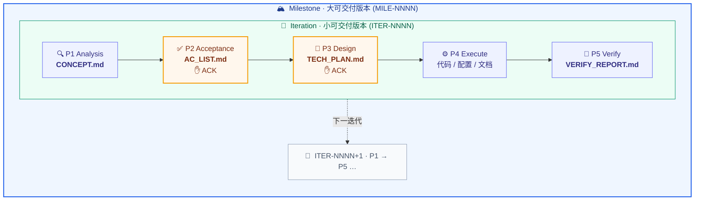

<div align="center">

# 🤖 Butler

**面向 AI 辅助工程开发的通用协作 SOP 规则仓库**

把 AI 从「自由发挥的编码助手」变成「按流程交付的工程协作者」


</div>

---

Butler 是一个 **Markdown 规则仓库**，定义了一套验收导向的需求开发 SOP，规范 AI 在真实项目中的协作流程：先对齐理解、再定义完成、再确认方案，最后才动手实现与验证。

## ✨ 核心特性

| | 能力 | 说明 |
|---|---|---|
| ✅ | **验收导向 SOP** | `P1→P5` 五阶段状态机，P2/P3 双 ACK 门控质量 |
| 🔁 | **迭代化** | `ITER-NNNN` 单调递增，需求 ACK 后冻结，文档归档可回溯 |
| 🏔 | **里程碑** | 大版本范围单元，聚合多个迭代、产出版本级交付 |
| 🧠 | **偏好蒸馏** | 采集你的设计取舍，蒸馏跨项目通识，在**有监督**工作里改进提议 |
| 🛡 | **Hook 门禁** | 阶段产物缺失或验收未冻结时机械拦截源码写操作 |
| 🧩 | **可插拔扩展** | 脑暴 / 自纠 / 审查 / 自治 / 偏好，按指令或语义触发 |
| 📦 | **基地车部署** | 新项目零配置接入，自动展开 `.ai/` 基础设施 |

## 🔄 核心工作流



> **两层范围单元**：每个 **迭代 `ITER-NNNN`** 跑一遍 `P1→P5`、独立交付；若干迭代组成一个 **里程碑 `MILE-NNNN`** 大版本，收口时聚合各迭代产出版本级交付。里程碑松耦合可选；每个阶段从上一阶段的产物文件读取，不依赖对话记忆。

## 🧭 三个子系统

每个子系统目录都可被独立引用作为入口；根 `README.md` 只负责总览与分流。

| 子系统 | 入口 | 用途 |
|---|---|---|
| 🛠 **Coder** | [`Coder/README.md`](Coder/README.md) | 工程开发与 AI 协作（核心） |
| 📚 **Learner** | [`Learner/README.md`](Learner/README.md) | 学习事务管理 &nbsp;`🚧 WIP` |
| 🗂 **Composer** | [`Composer/README.md`](Composer/README.md) | 其他生活 / 事务性杂项 &nbsp;`🚧 WIP` |

## 🧩 扩展模式

默认不启用，通过指令或语义触发：

| 模式 | 触发 | 用途 |
|---|---|---|
| 💡 **Ideation** | `/ideation` | 需求脑暴与完善 |
| 🔁 **收敛闭环** | `/loop` | 高强度纠错升档（死磕到绿 + 定量熔断） |
| 🔎 **Review** | `/review` | 代码审查：P5 默认简评 + opt-in 独立复核（fresh-context 子 agent，手动 / 项目配置） |
| ⚠️ **Dangerous** | `/dangerous` | 无人值守长程自治（实验性） |
| 🧠 **Preference** | `/preference` | 跨项目偏好蒸馏（实验性 · 采集经同意默认开 / 反哺 opt-in） |

## 🚀 快速上手

```bash
# 1. 一次性全局安装（写入全局配置 + 把 slash 命令软链进 ~/.claude/commands/，
#    之后所有项目自动发现 butler 规则、并能用 /butler-* 命令）
./scripts/setup.sh

# 2. 可选 · 启用偏好探针（opt-in，数据外置）
./scripts/preference-init.sh
```

3. **接入新项目**：在任何项目里直接给任务 — AI 自动读规则、检测到新项目后部署基地车，按 P1-P5 推进。
4. **详细说明**：阅读 [`HUMAN_GUIDE.md`](HUMAN_GUIDE.md)。

## 📂 目录结构

```txt
butler/
├── README.md                       # 本文件 · 总览与分流
├── CLAUDE.md                       # 给 AI 的仓库开发约定
├── HUMAN_GUIDE.md                  # 面向人类的操作手册
│
├── scripts/
│   ├── setup.sh                    # 一次性全局安装（含 slash 命令软链到 ~/.claude/commands/）
│   └── preference-init.sh          # 偏好探针存储初始化（opt-in）
│
├── .claude/commands/               # butler slash 命令（setup.sh 软链到全局，所有项目可用）
│   └── butler-prd.md               #   /butler-prd · PRD 先行薄壳路由
│
├── templates/                      # 目标项目落地物
│   ├── CLAUDE.md.template
│   ├── rule-card.md                #   浓缩规则卡（强约束 SSOT）
│   ├── hooks/                      #   PreToolUse 流程门禁
│   ├── settings.hooks-snippet.json
│   └── preference/                 #   偏好探针外置存储骨架
│
├── Coder/                          # 🛠 工程开发与 AI 协作（核心）
│   ├── README.md                   #   子系统入口
│   ├── architecture-overview.md    #   规则分层与启用关系
│   ├── 00_System_Prompt/           #   身份与总调度
│   ├── 10_Domain_Stack_Profiles/   #   技术栈 profile（按需启用）
│   ├── 20_Workflow_Lifecycle/      #   P1-P5 状态机 · 迭代 · 里程碑 · 交付
│   ├── 30_Quality_Gate/            #   质量门禁
│   ├── 40_Context_Management/      #   长任务上下文治理
│   ├── 50_Extension_Ideation/      #   脑暴        /ideation
│   ├── 55_Extension_ConvergenceLoop/ # 收敛闭环    /loop
│   ├── 60_Extension_CodeReview/    #   代码审查    /review
│   ├── 65_Extension_Dangerous/     #   无人值守自治 /dangerous ⚠️
│   ├── 70_Extension_Preference/    #   偏好探针    /preference ⚠️
│   └── 99_Business_Extension/      #   业务约束（最高优先级）
│
├── Learner/                        # 📚 学习事务管理
├── Composer/                       # 🗂 其他杂项事务
└── deliveries/                     # butler 自身的交付总结归档（dogfooding）
```

---

<div align="center">

开发按**迭代**推进 · 需求 ACK 后**冻结** · 文档落盘**可回溯**

机制详见 [`Coder/20_Workflow_Lifecycle/`](Coder/20_Workflow_Lifecycle/) · 用法详见 [`HUMAN_GUIDE.md`](HUMAN_GUIDE.md)

</div>
