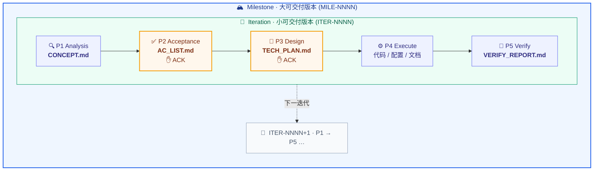

<div align="center">

# 🤖 Butler

**面向 AI 辅助工程开发的通用协作 SOP 规则仓库**

把 AI 从「自由发挥的编码助手」变成「按流程交付的工程协作者」


</div>

---

## 一句话说清

Butler 是一套**验收导向的开发协作 SOP**，把任意项目的需求开发过程固定为五阶段流水线——先对齐理解、再定义验收、再确认方案，最后才动手实现与验证。每个阶段产出落盘文件，Hook 门禁在产物缺失或验收未冻结时机械拦截写码操作。

## ✨ 核心特性

| | 能力 | 说明 |
|---|---|---|
| ✅ | **验收导向 SOP** | `P1→P5` 五阶段状态机，P2/P3 双 ACK 门控质量 |
| 🔁 | **迭代化** | `ITER-NNNN` 单调递增，需求 ACK 后冻结，文档归档可回溯 |
| 🏔 | **里程碑** | 大版本范围单元，聚合多个迭代产出交付；支持候办区延迟编号，开工才领号 |
| 🎯 | **Goal 体系** | 从里程碑/迭代产物自动派生 Goal 合同，运行时信号回注校准，完成资格裁决 |
| 🧠 | **偏好蒸馏** | 采集设计取舍，蒸馏跨项目通识，只作用于有监督工作 |
| 🛡 | **Hook 门禁** | 阶段产物缺失或验收未冻结时，PreToolUse hook 机械拦截源码写入 |
| 📦 | **基地车部署** | 新项目零配置接入，`/butler:init` 一键展开 `.ai/` 基础设施 |
| 🤝 | **三宿主** | Claude Code / Codex / Pi 均可发现规则并协作 |

## 🔄 核心工作流



> 每个 **迭代 `ITER-NNNN`** 跑一遍 `P1→P5`、独立交付；若干迭代组成一个 **里程碑 `MILE-NNNN`** 大版本。里程碑松耦合可选；每个阶段从上一阶段产物文件读取，不依赖对话记忆。

Butler 命令入口、双宿主名称、风险级别与旧名兼容以机器注册表生成的 [`docs/workflows.md`](docs/workflows.md) 为准。

## 🚀 快速上手

```bash
# 1. 一次性全局安装——Claude 配置/命令/风格 + Codex plugin + Pi 适配器
./scripts/setup.sh

# 2. 可选 · 偏好探针初始化（opt-in，数据外置，与本仓库解耦）
./scripts/preference-init.sh
```

3. **新项目接入**：给 AI 任务时点名项目路径；或在新项目内执行 `/butler:init` 一键部署基地车。
4. **升级已有项目**：`/butler:upgrade`，走迁移配方、先 dry-run 再事务 apply。
5. **详细手册**：[`HUMAN_GUIDE.md`](HUMAN_GUIDE.md)

### 🏗 多宿主支持

Butler 规则算法以 `Coder/` 为单一真源，各宿主通过薄适配层接入：

| 宿主 | 发现入口 | 适配层 | 门禁 |
|---|---|---|---|
| **Claude Code** | `CLAUDE.md` + `.claude/commands/` | 原生 | Python PreToolUse hook |
| **Codex** | `AGENTS.md` | `plugins/butler/`（11 skills） | Python hook（`apply_patch` 适配） |
| **Pi** | `AGENTS.md` | `plugins/butler-pi/`（TypeScript 扩展） | TS 拦截 `tool_call` → Python 门禁 |

> 一次 `setup.sh` 统一安装三宿主。新项目从同一 `rule-card.md` 生成 `CLAUDE.md` + `AGENTS.md`，既有项目升级由 `tools/butler-upgrade/` 处理。首次启用 hook 须用户审阅信任；PreToolUse 不是 sandbox。兼容边界详见 [`docs/codex-compatibility.md`](docs/codex-compatibility.md)。

## 🧩 扩展命令

全部为可选，通过指令或语义触发：

| 命令 | 用途 |
|---|---|
| `/butler:inbox` | 扫描、分类并安全路由需求收件箱 |
| `/butler:prd` | PRD 切分 / 版本管理 / 改版同步 |
| `/butler:milestone` | 里程碑录入 / 候办区 / 只读看板 |
| `/butler:review` | 代码审查（P5 简评 + 可选独立复核） |
| `/butler:progress` | 结构化进度总览（里程碑 / 迭代 / Goal / 验收 / 风险） |
| `/butler:init` | 新项目基地车一键部署 |
| `/butler:upgrade` | 已部署项目升级到最新版 |
| `/butler:ideation` | 需求脑暴（不进执行主线） |
| `/butler:preference` | 偏好探针开关（采集/反哺，实验性） |
| `/butler:loop` ⚠️ | 收敛闭环——高强度死磕纠错 + 定量熔断 |
| `/butler:dangerous` ⚠️ | 无人值守长程自治（实验性） |

> 命令靠 `setup.sh` 软链全局分发，新增命令自动在所有项目可用，无需重跑安装。

## ✅ 持续验证

**本地一键验证**（与 CI 同入口）：

```bash
bash scripts/verify-ci.sh
```

覆盖内容：固定 Python 工具链（`.python-version` + `uv.lock`），运行双宿主安装、状态审计、Codex plugin/skills/hooks、Pi 适配器、Markdown 链接及 CI 契约测试。

**CI 自动运行**：`.github/workflows/ci.yml` 在 PR、`main` push 和 `v*` tag 上，以 `ubuntu-24.04` + `macos-14` 执行同一入口。matrix 全部通过后汇总为 `Butler required checks`。

> **关于 Required Check 的配置**：workflow 提供 check 不等于 GitHub 已把它设为 required。管理员需先在 `main` 的 Ruleset / Branch protection 中手动选择 `Butler required checks`，再用 API 远端确认。在远端证据到位前，状态只能写 `pending external configuration`。

## 🧭 规则体系

核心规则在 `Coder/` 目录下按职责分层：

| 层 | 目录 | 职责 |
|---|---|---|
| 系统提示 | `00_System_Prompt/` | 协作身份、总调度协议、输出呈现规范 |
| 领域模板 | `10_Domain_Stack_Profiles/` | 技术栈 profile，按项目类型按需启用 |
| **流程核心** | `20_Workflow_Lifecycle/` | P1–P5 状态机 · 迭代 · 里程碑 · 部署 · 升级 · 交付 |
| 质量门禁 | `30_Quality_Gate/` | 纠错契约 · 最小实现纪律 · 自动化优先 · 验证分道 |
| 上下文治理 | `40_Context_Management/` | 长任务 · 交接 · PRD 切分与改版 · 知识文件夹 |
| 扩展模块 | `50~70_Extension_*/` | 脑暴 · 收敛闭环 · 审查 · 帮手名册 · 自治 · 偏好 |
| 业务约束 | `99_Business_Extension/` | 项目级最高优先级业务规则 |

> 入口：[`Coder/README.md`](Coder/README.md)，内含完整读取顺序。

## 📦 目录结构

```txt
butler/
├── README.md                       # 本文件
├── CLAUDE.md / AGENTS.md           # AI 仓库约定（Claude / Codex 双入口）
├── HUMAN_GUIDE.md                  # 人类操作手册
├── communication-style.md          # 个人沟通风格正本（全局常开，非 SOP 规则）
├── VERSION                         # 版本号机器真源
├── CHANGELOG.md                    # 发布历史
├── pyproject.toml / uv.lock        # 固定 Python 验证依赖
│
├── scripts/                        # 安装 · 审计 · 渲染 · 验证脚本
│   ├── setup.sh                    #   三宿主一次性全局安装
│   ├── render-project-entrypoints.py # 幂等生成/升级 CLAUDE.md + AGENTS.md
│   ├── verify-ci.sh                #   本地/CI 唯一完整验证入口
│   └── ...                         #   （共 13 个脚本，详见目录内）
│
├── tools/                          # Butler 驻留工具（不拷进目标项目，按 $BUTLER 调用）
│   ├── butler-upgrade/             #   manifest 驱动的 dry-run / 事务升级器
│   ├── goal-assurance/             #   Goal 完成资格只读裁决器
│   ├── verification-evidence/      #   自动道证据：命令/exit/log/hash 记录
│   ├── delivery-selftest/          #   人测回传桥：浏览器四态路由
│   └── codex-validators/           #   OpenAI Codex 官方 validator 快照
│
├── .claude/commands/butler/        # /butler:* 命令（11 个，全局软链分发）
├── plugins/butler/                 # Codex plugin（11 skills 实体真源）
├── plugins/butler-pi/              # Pi 宿主适配器（TypeScript）
├── .agents/skills/                 # 仓库发现面（11 个相对软链）
│
├── Coder/                          # 🛠 规则真源（核心）
│   ├── README.md                   #   子系统入口 + 读取顺序
│   ├── 00_System_Prompt/           #   身份与总调度
│   ├── 10_Domain_Stack_Profiles/   #   技术栈 profile
│   ├── 20_Workflow_Lifecycle/      #   P1-P5 状态机 · 迭代 · 里程碑
│   ├── 30_Quality_Gate/            #   质量门禁
│   ├── 40_Context_Management/      #   上下文治理
│   ├── 50~70_Extension_*/          #   扩展模块
│   └── 99_Business_Extension/      #   业务约束
│
├── templates/                      # 目标项目落地模板
│   ├── CLAUDE.md.template / AGENTS.md.template
│   ├── rule-card.md                #   浓缩规则卡（SSOT）
│   ├── delivery.html.template      #   交付总结 HTML 视图模板
│   ├── hooks/                      #   PreToolUse 流程门禁
│   └── preference/                 #   偏好探针外置存储骨架
│
├── migrations/                     # 迁移配方（每版一份）
├── workflows/                      # 工作流注册表
├── docs/                           # 兼容边界 + 注册表人读版
└── deliveries/                     # 自身交付总结归档（dogfooding）
```

---

<div align="center">

开发按**迭代**推进 · 需求 ACK 后**冻结** · 文档落盘**可回溯**

机制详见 [`Coder/20_Workflow_Lifecycle/`](Coder/20_Workflow_Lifecycle/) · 用法详见 [`HUMAN_GUIDE.md`](HUMAN_GUIDE.md)

</div>
