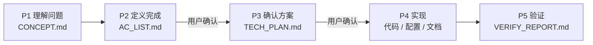
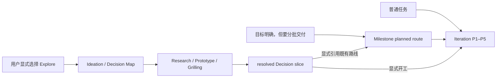

<div align="center">

# Butler

**面向 AI 工程协作的验收导向 SOP**

让 AI 先理解目标、明确验收、确认方案，再实现并拿证据交付。

[](https://github.com/hidetodong/butler/actions/workflows/ci.yml)
[](CHANGELOG.md)
[](LICENSE)
[](#三宿主如何共享同一套规则)

</div>

Butler 是一套 Markdown 规则和配套工具，不是代码框架。它把 AI 开发过程沉淀到项目内的 `.ai/`：需求怎么理解、什么算完成、准备怎么改、验证结果如何，都有明确文件可查，不再依赖一段容易丢失的对话。

## 它解决什么问题

- **避免没对齐就写代码**：标准流程在实现前先确认验收标准和技术方案。
- **让长任务可以接着做**：迭代状态、阶段产物和交接信息都落在项目里，新会话能恢复现场。
- **让“做完了”有证据**：验证记录必须对应验收项，失败、弱验证和待人工确认的部分如实保留。
- **让流程约束真正生效**：部署后的 Hook 会在关键产物缺失或未通过门禁时阻止源码写入。

## 目录

- [它解决什么问题](#它解决什么问题)
- [工作方式](#工作方式)
- [快速开始](#快速开始)
- [普通任务、Milestone 与 Explore](#普通任务milestone-与-explore)
- [一分钟示例](#一分钟示例)
- [你会在项目里得到什么](#你会在项目里得到什么)
- [功能清单](#功能清单)
- [三宿主如何共享同一套规则](#三宿主如何共享同一套规则)
- [仓库结构](#仓库结构)
- [维护与验证](#维护与验证)
- [继续阅读](#继续阅读)
- [支持与维护](#支持与维护)
- [参与贡献](#参与贡献)
- [安全](#安全)
- [许可证](#许可证)

## 工作方式

每个非极小任务默认走一轮 `P1 → P5`：



| 阶段 | 回答的问题 | 主要产物 |
|---|---|---|
| P1 Analysis | 我们到底要解决什么？ | `.ai/CONCEPT.md` |
| P2 Acceptance | 什么结果才算完成？ | `.ai/AC_LIST.md` |
| P3 Design | 准备怎么改，风险在哪里？ | `.ai/TECH_PLAN.md` |
| P4 Execute | 按已确认范围完成实现 | 代码、配置或文档 |
| P5 Verify | 验收项是否有证据证明？ | `.ai/VERIFY_REPORT.md` |

一轮 P1–P5 是一个可独立交付的**迭代**（`ITER-NNNN`）。需要多个迭代共同完成的大版本，可以再用可选的**里程碑**（`MILE-NNNN`）组织；只有真正开工时才编号，讨论中的方向先放候办区。

## 快速开始

### 1. 准备环境

首次使用需要：

- Git、Bash 和 Python 3。
- Claude Code、Codex 或 Pi 中至少一个宿主；未安装的宿主会被跳过。
- macOS 或 Linux。仓库 CI 当前在 macOS 14 和 Ubuntu 24.04 上验证；Windows 原生环境尚未纳入验证矩阵。

### 2. 获取并安装 Butler

```bash
git clone https://github.com/hidetodong/butler.git
cd butler
bash scripts/setup.sh
```

运行前请知道它会修改用户级配置：

- 在现有 `~/.zshrc` 或 `~/.bashrc` 中写入 `BUTLER_PATH`；两者都不存在时会提示你手动配置。
- 更新 `~/.claude/CLAUDE.md` 并维护 Butler 命令软链。
- 检测到 Codex CLI 时，在用户插件目录安装或刷新 Butler plugin。
- 检测到 Pi CLI 时，在 `~/.pi/agent/extensions/` 安装 Butler 扩展。

安装器会先检查冲突，再以可重复运行的方式更新已认领内容。它只安装机器级能力，不会初始化你的业务项目；首次启用 Hook 或 plugin 时仍应审阅并确认信任。完整写入边界和故障处理见 [使用指南](HUMAN_GUIDE.md#3-安装一次性)。

安装完成后重启终端，或重新加载当前 shell 配置：

```bash
source ~/.zshrc  # 使用 Bash 时改为 source ~/.bashrc
test -n "$BUTLER_PATH" && test -f "$BUTLER_PATH/Coder/README.md" && echo "Butler ready"
```

看到 `Butler ready` 表示路径已经生效。对应宿主需要新开会话，才能加载刚安装的命令、plugin 或扩展。

### 3. 接入项目

在目标项目中开启新的 AI 会话，然后使用对应入口：

| 宿主 | 显式入口 |
|---|---|
| Claude Code | `/butler:init` |
| Codex | `$butler-init` |
| Pi | 直接说“用 Butler 初始化当前项目” |

也可以直接给任务并点名项目路径。AI 发现目标项目尚无 `.ai/` 时，会按同一协议完成初始化；如果所在目录包含多个项目，它会先要求你明确目标，不会猜测施工位置。

### 4. 正常描述任务

```text
在 /path/to/project 实现登录失败后的账号锁定，并补齐验证。
```

普通任务默认从迭代入口开始；流程内再按既有规则决定走简化或完整 P1–P5。完整流程中，你主要在 P2 确认“什么算完成”，在 P3 确认“准备怎么做”；实现和验证完成后，会得到迭代归档以及 Markdown、HTML 两种交付总结。

已有 Butler 项目需要同步到当前版本时，使用 `/butler:upgrade`（Claude Code）或 `$butler-upgrade`（Codex）。升级会先给出零写入计划，确认后才事务执行。

## 普通任务、Milestone 与 Explore

三者不是三个互相竞争的入口，而是解决不同问题：**Iteration 管一次交付，Milestone 管多次交付，Explore 管开工前尚未收敛的关键决策。** Butler 不依赖模型先猜“需求有多大、够不够清晰”再自动分流；默认仍按普通任务处理，只有用户明确选择 Explore，或接受 AI 针对具体阻塞点提出的 Explore 建议，才进入持久化探索。

| 你的情况 | 建议路径 | 原因 |
|---|---|---|
| 目标和下一步已经明确，预计一次能交付 | 直接开始 Iteration | 不增加前置流程 |
| 目标明确，但需要多个 Iteration | 先建立 Milestone，再启动第一个 Iteration | 路线问题已解决，只需要组织交付 |
| 存在会阻塞路线的未知项，而且要跨会话求证、比较或并行探索 | 显式选择 Explore | 需要保存 Decision、证据、依赖和待办前沿 |
| 只是想快速聊想法 | 使用轻量 Ideation，不建立 Decision Map | 保持低成本，随时可结束 |

Explore 仍使用现有 Ideation 入口，没有新增一套命令：

| 宿主 | 入口 |
|---|---|
| Claude Code | `/butler:ideation` |
| Codex | `$butler-ideation` |
| Pi | 直接说“用 Explore 帮我梳理这个方向，先不要开 Iteration” |

例如：

```text
用 Explore 帮我梳理离线同步方案。把会阻塞路线的决策和证据保存下来，
可以做 Research 或 Prototype，但先不要建立 Milestone，也不要开 Iteration。
```



Decision Map 记录的是“为什么这样选”的参考来源，不是新的交付计划，也不会自动变成 Milestone 或 Iteration。交接必须由用户明确指定已解决的 Decision slice 和目标：

```text
把 DMAP-0001 中已经解决的离线冲突策略作为参考，
接到 MILE-0015 的 planned route；先不要启动 Iteration。
```

或者直接开工：

```text
用 DMAP-0001 已解决的 D-003 作为输入，启动一个 Iteration；从 P1 开始。
```

这里有三条固定边界：Explore 不替代 Milestone 的多迭代路线管理；promotion 只负责显式交接，不创建隐含路线、不跳过 P1；模型可以建议 Explore，但不能仅凭“看起来很大或不清晰”自动开启它。跨会话继续时，只需说“继续当前 Decision Map，先告诉我 Frontier 和下一步”，Butler 会从落盘状态恢复，而不是重新猜测上次讨论。

## 一分钟示例

在已经接入 Butler 的项目里，直接告诉 AI 目标和项目路径：

```text
在 /path/to/project 实现登录失败后的账号锁定，并补齐验证。
```

一个完整迭代通常会发生这些事：

1. AI 先把问题理解写进 `.ai/CONCEPT.md`。
2. 你在 P2 确认 `.ai/AC_LIST.md` 中“什么算完成”。
3. 你在 P3 确认 `.ai/TECH_PLAN.md` 中“准备怎么改”。
4. AI 实现并验证，将证据写进 `.ai/VERIFY_REPORT.md`。
5. 收口后，冻结产物进入 `.ai/iterations/ITER-NNNN/`，并在 `deliveries/` 生成 Markdown、HTML 两种交付总结。

因此，新会话接手时读的是项目里的目标、状态和证据，而不是猜测上一段对话发生过什么。

## 你会在项目里得到什么

```text
project/
├── CLAUDE.md / AGENTS.md       # Claude Code / Codex 项目入口
├── .ai/
│   ├── CONCEPT.md              # 当前迭代的问题理解
│   ├── AC_LIST.md              # 冻结后的验收标准
│   ├── TECH_PLAN.md            # 通过准入的技术方案
│   ├── VERIFY_REPORT.md        # 验证结果与剩余风险
│   ├── ITERATIONS.md           # 迭代台账
│   ├── task-state.md           # 当前运行状态
│   ├── project/                # 项目长期知识
│   └── iterations/             # 已收口迭代快照
├── deliveries/                 # 给人阅读的 .md / .html 交付总结
└── origin/                     # 可选的原始需求收件箱，AI 只读
```

完整布局、旁路 Agent 回执、PRD 管理和版本升级说明见 [使用指南](HUMAN_GUIDE.md)。

## 功能清单

Butler 的能力按项目接入、需求进入、迭代推进和跨阶段协作组织。命令只是明确入口；普通能力也可以通过自然语言触发。

### 项目接入与版本维护

| 功能 | 作用 | Claude Code / Codex 入口 |
|---|---|---|
| 机器级安装与刷新 | 安装三宿主入口、命令、插件和适配器 | `/butler:setup` · `$butler-setup` |
| 项目初始化 | 在目标项目部署 `.ai/`、双宿主入口和 Hooks | `/butler:init` · `$butler-init` |
| 项目升级 | 先生成零写入计划，再按迁移配方事务升级 | `/butler:upgrade` · `$butler-upgrade` |

### 需求进入与范围规划（P1 之前及 P1）

| 功能 | 所处阶段 | 作用 | Claude Code / Codex 入口 |
|---|---|---|---|
| Explore / 需求脑暴 | P1→P5 之外 | 用户主动探索或接受具体建议后梳理 Decision Map；显式 promotion 才从 Iteration P1 接回 | `/butler:ideation` · `$butler-ideation` |
| 需求收件箱 | P1 之前 | 扫描来源、分类并路由原始需求材料 | `/butler:inbox` · `$butler-inbox` |
| PRD 管理 | P1–P3 输入 | 切分、查询和更新可独立版本化的产品需求 | `/butler:prd` · `$butler-prd` |
| 里程碑与候办 | 迭代外层 | 规划多迭代版本，或暂存尚未开工的方向 | `/butler:milestone` · `$butler-milestone` |

### 迭代推进与质量闭环（P1–P5）

| 功能 | 所处阶段 | 作用 | 入口 |
|---|---|---|---|
| 标准迭代 | P1–P5 | 按理解、验收、方案、实现、验证完成一次独立交付 | 默认流程，无需命令 |
| 进度总览 | 任意阶段 | 汇总里程碑、迭代、Goal、验收、验证和风险 | `/butler:progress` · `$butler-progress` |
| Goal 校准与裁决 | P3–P5 | 让实现偏差和坏消息回流，并用证据判断能否完成 | 默认随完整流程运行 |
| 验证与交付 | P5 | 记录自动验证、人测残余、证据强度和剩余风险 | 默认随完整流程运行 |
| 代码与产物复核 | P5 或按需 | 复核实现、阶段产物和验收覆盖，可选择独立复核 | `/butler:review` · `$butler-review` |
| 高强度纠错 | P4 | 在常规纠错之上持续探测、修正并按上限熔断 | `/butler:loop` · `$butler-loop`（必须显式开启） |
| 无人值守自治 | P1–P5 外层 | 自主拆迭代并以自审代替阶段确认，保留审计与回滚边界 | `/butler:dangerous` · `$butler-dangerous`（必须显式开启） |

### 上下文与协作扩展（跨阶段）

| 功能 | 作用 | 入口 |
|---|---|---|
| 会话恢复与项目知识 | 把当前断点和长期事实落盘，让新会话从项目状态继续 | 自动维护 `.ai/02_SESSION_HANDOFF.md` 与 `.ai/project/` |
| 旁路工作回执 | 把另一个 Agent 完成的代码或调研成果显式钩回主线 | 用户提供 `.ai/sidework/` 回执路径 |
| 偏好学习 | 经同意采集真人取舍，在有监督工作中改进提议 | `/butler:preference` · `$butler-preference` |

Loop 与 Dangerous 相互独立，也都不会因为普通任务自动启用。完整命令、触发条件和兼容旧名以机器注册表生成的 [工作流清单](docs/workflows.md) 为准。

## 三宿主如何共享同一套规则

| 宿主 | 项目发现入口 | 适配方式 |
|---|---|---|
| Claude Code | `CLAUDE.md` | `/butler:*` 命令与 Python Hooks |
| Codex | `AGENTS.md` | `plugins/butler/` skills 与 Python Hooks |
| Pi | `AGENTS.md` | `plugins/butler-pi/` TypeScript 扩展 |

规则算法只维护在 `Coder/`，宿主入口只负责发现和适配，不各自复制一套流程。Hook 是流程门禁，不是操作系统 sandbox；首次启用时仍应审阅并确认信任。双宿主边界和验证矩阵见 [Codex 兼容说明](docs/codex-compatibility.md)。

## 仓库结构

```text
butler/
├── LICENSE                 # Butler 自身的 Apache-2.0 许可证
├── CONTRIBUTING.md         # Issue、Pull Request 与本地验证约定
├── SECURITY.md             # 私密漏洞报告与支持版本
├── Coder/                  # P1–P5、质量门禁、上下文与扩展规则真源
├── plugins/                # Codex plugin 与 Pi 适配器
├── templates/              # 项目入口、Hook、交付等模板
├── tools/                  # 升级、证据、Goal、handoff 等驻留工具
├── scripts/                # 安装、生成、审计和完整验证入口
├── workflows/              # 双宿主工作流机器注册表
├── migrations/             # 已部署项目的版本迁移配方
├── docs/                   # 兼容边界和专项说明
└── deliveries/             # Butler 自身的迭代与里程碑交付历史
```

规则分层、读取顺序和文件职责从 [Coder/README.md](Coder/README.md) 开始。人类操作说明从 [HUMAN_GUIDE.md](HUMAN_GUIDE.md) 开始。

## 维护与验证

修改 Butler 本身后，运行与 CI 相同的完整入口：

```bash
bash scripts/verify-ci.sh
```

CI 会验证规则投影、Claude/Codex/Pi 适配、Hooks、状态与产物审计、Markdown 链接和各驻留工具。GitHub 上最终汇总检查名为 `Butler required checks`；是否设为分支必需检查仍需仓库管理员在 Ruleset 或 Branch protection 中配置。

长期运行项目如果需要迁移大体量 ITER/MILE 台账，再使用 [`tools/state-ledger/`](tools/state-ledger/) 的 `inspect → migrate → check` 流程；它是维护工具，不是首次使用步骤。

Explore 中需要结构化、跨会话或并行的 Decision Map 时，使用 [`tools/decision-map/`](tools/decision-map/) 的 `inspect → plan → apply → verify` Interface。它是 opt-in Explore 的内部持久化能力，不是新的入口，也不会自动判断需求大小或把探索结果送入 Milestone/Iteration。

对已显式选择并 claim 的 Decision 做受控求证时，使用 [`tools/decision-work/`](tools/decision-work/) 的同名四动作 Interface。它保存不可变 Task/Result；只有 Research 求证可以受控并行，候选结果必须由协调器显式 absorb 才能解决 Decision，不会自动进入交付流程。

用户明确选择 resolved Decision slice 及目标后，使用 [`tools/decision-promotion/`](tools/decision-promotion/) 的同名四动作 Interface。`route-reference` 只引用既有 Milestone planned route；`iteration-start` 复用现有 intake 从 P1 开工。它不判断需求大小/清晰度、不创建路线、不自动进入 P2，Decision Map 此后只是参考来源。

三段能力的端到端本地回归由 [`tools/explore-dogfood/`](tools/explore-dogfood/) 编排；它不是新入口或状态真源。MILE-0014 R5 的真实样本、四项观测和外部 tracker `defer` 裁决见 [`docs/explore-dogfood-r5.md`](docs/explore-dogfood-r5.md)。当前结论是：这套持久化探索适合确有跨会话阻塞决策的大需求，不应成为普通任务或轻量 Ideation 的默认路径。

## 继续阅读

- [HUMAN_GUIDE.md](HUMAN_GUIDE.md)：安装、项目接入和日常使用
- [Coder/README.md](Coder/README.md)：规则体系入口与读取顺序
- [docs/workflows.md](docs/workflows.md)：全部 Claude Code / Codex 工作流入口
- [docs/codex-compatibility.md](docs/codex-compatibility.md)：双宿主边界与兼容矩阵
- [CHANGELOG.md](CHANGELOG.md)：版本发布历史

## 支持与维护

普通使用问题、Bug 和功能建议请提交到 [GitHub Issues](https://github.com/hidetodong/butler/issues)。提交前先搜索是否已有同类问题，并附上 Butler 版本、宿主、操作系统和最小复现步骤。

当前维护者是 [@hidetodong](https://github.com/hidetodong)。安全问题不要提交公开 Issue，请走下面的私密报告入口。

## 参与贡献

Butler 接受 Issues 和 Pull Requests。提交改动前请阅读 [贡献指南](CONTRIBUTING.md)，按范围修改并运行与 CI 相同的验证入口；无法运行的检查必须如实写明，不能把未执行描述成已通过。

## 安全

未修复漏洞请通过 GitHub Private Vulnerability Reporting 私下报告，不要公开披露复现细节。受支持版本、报告内容和协调披露流程见 [安全策略](SECURITY.md)。

## 许可证

Butler 采用 [Apache License 2.0](LICENSE)，SPDX 标识为 `Apache-2.0`。

Copyright © 2026 hidetodong。仓库中标有独立许可证的第三方组件仍分别适用其自身条款。
