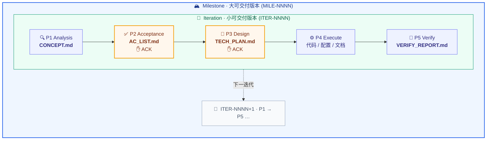

<div align="center">

# 🤖 Butler

**面向 AI 辅助工程开发的通用协作 SOP 规则仓库**

把 AI 从「自由发挥的编码助手」变成「按流程交付的工程协作者」


</div>

---

Butler 是一个 **Markdown 规则仓库**，定义了一套验收导向的需求开发 SOP，规范 AI 在真实项目中的协作流程：先对齐理解、再定义完成、再确认方案，最后才动手实现与验证。

## ✨ 核心特性

| | 能力 | 说明 |
|---|---|---|
| ✅ | **验收导向 SOP** | `P1→P5` 五阶段状态机，P2/P3 双 ACK 门控质量 |
| 🔁 | **迭代化** | `ITER-NNNN` 单调递增，需求 ACK 后冻结，文档归档可回溯 |
| 🏔 | **里程碑** | 大版本范围单元，聚合多个迭代、产出版本级交付；候办区延迟编号，开工才领号 |
| 🎯 | **Goal 体系** | 从里程碑/迭代产物自动派生 Goal 合同，运行时信号回注校准，完成资格裁决 |
| 🧠 | **偏好蒸馏** | 采集你的设计取舍，蒸馏跨项目通识，在**有监督**工作里改进提议 |
| 🛡 | **Hook 门禁** | 阶段产物缺失或验收未冻结时机械拦截源码写操作 |
| 🧩 | **可插拔扩展** | 脑暴 / 自纠 / 审查 / 自治 / 偏好 / 初始化 / 进度，按指令或语义触发 |
| 📦 | **基地车部署** | 新项目零配置接入，自动展开 `.ai/` 基础设施；`/butler:init` 一键触发 |
| 🤝 | **三宿主工作流** | Claude Code / Codex / Pi 均可发现规则并协作；Codex 通过 `plugins/butler/` 使用 10 个 Butler skills |

## 🔄 核心工作流



> **两层范围单元**：每个 **迭代 `ITER-NNNN`** 跑一遍 `P1→P5`、独立交付；若干迭代组成一个 **里程碑 `MILE-NNNN`** 大版本，收口时聚合各迭代产出版本级交付。里程碑松耦合可选；每个阶段从上一阶段的产物文件读取，不依赖对话记忆。

## 🧭 三个子系统

每个子系统目录都可被独立引用作为入口；根 `README.md` 只负责总览与分流。

| 子系统 | 入口 | 用途 |
|---|---|---|
| 🛠 **Coder** | [`Coder/README.md`](Coder/README.md) | 工程开发与 AI 协作（核心） |
| 📚 **Learner** | [`Learner/README.md`](Learner/README.md) | 学习事务管理 &nbsp;`🚧 WIP` |
| 🗂 **Composer** | [`Composer/README.md`](Composer/README.md) | 其他生活 / 事务性杂项 &nbsp;`🚧 WIP` |

## 🧩 扩展模式

默认不启用，通过指令或语义触发：

| 模式 | 触发 | 用途 |
|---|---|---|
| 💡 **Ideation** | `/ideation` | 需求脑暴与完善 |
| 🚀 **Init** | `/butler:init` | 新项目基地车一键部署 |
| 📊 **Progress** | `/butler:progress` | 结构化进度总览（里程碑 / 迭代 / 验收 / 风险） |
| 🔁 **收敛闭环** | `/butler:loop` | 高强度纠错升档（死磕到绿 + 定量熔断） |
| 🔎 **Review** | `/review` | 代码审查：P5 默认简评 + opt-in 独立复核（fresh-context 子 agent，手动 / 项目配置） |
| ⚠️ **Dangerous** | `/butler:dangerous` | 无人值守长程自治（实验性） |
| 🧠 **Preference** | `/butler:preference` | 跨项目偏好蒸馏（实验性 · 采集经同意默认开 / 反哺 opt-in） |

## 🚀 快速上手

```bash
# 1. 一次性全局安装（Claude 全局配置/命令/风格 + 检测并安装 Codex plugin）
./scripts/setup.sh

# 2. 可选 · 启用偏好探针（opt-in，数据外置）
./scripts/preference-init.sh
```

3. **接入新项目**：直接给任务并点名项目/仓库路径；若会话已在该 Git/Butler 项目内，AI 也可安全发现其根。多仓父目录不会被自动当成项目。
4. **详细说明**：阅读 [`HUMAN_GUIDE.md`](HUMAN_GUIDE.md)。

> **多宿主支持**：v2.15.0 起，一次运行 `./scripts/setup.sh` 即统一安装 Claude 能力与 Codex plugin；v2.18.0 起新增 Pi 宿主适配器（`plugins/butler-pi/`，TypeScript 扩展拦截写操作调 Python 门禁）。新项目从同一规则卡生成 `CLAUDE.md` + `AGENTS.md`，既有项目升级由 `tools/butler-upgrade/upgrade.py` 读取机器 manifest，先 dry-run、再事务 apply。Codex 具备 10 个 skills 和已验证的 `apply_patch` 门禁/提醒；首次启用 hook 仍须用户审阅并信任。PreToolUse 不是 sandbox，未承诺覆盖 shell/MCP 等其他写路径。入口、风险与兼容旧名以自动生成的 [`docs/workflows.md`](docs/workflows.md) 为准；兼容边界详见 [`docs/codex-compatibility.md`](docs/codex-compatibility.md)。

## ✅ 持续验证

本地与 GitHub Actions 共用一条完整验证命令：

```bash
bash scripts/verify-ci.sh
```

它按 `.python-version`、`pyproject.toml` 和 `uv.lock` 使用固定 Python/依赖，随后运行双宿主、安装器、状态/证据、Codex plugin/skills/hooks、Markdown 链接及 CI 契约测试。第一次运行需要已安装精确版本的 uv；脚本发现版本不符会直接失败并报告期望值，不会临时改用最新版。

`.github/workflows/ci.yml` 在 pull request、`main` push 和 `v*` tag 上用 `ubuntu-24.04`、`macos-14` 执行同一入口。所有 matrix leg 通过后才会产生稳定汇总 check：**`Butler required checks`**。

“workflow 已提供 check”和“GitHub 已把它设为 required”是两件事：

1. 先把 workflow 推到 GitHub，并让它至少成功运行一次，产生 `Butler required checks`。
2. 仓库管理员在 `main` 的 Ruleset 或 Branch protection 中启用 required status checks，选择精确名称 `Butler required checks`。
3. 回到对应保护设置复核该名称；也可用只读 `gh api repos/{owner}/{repo}/rulesets` 或 branch protection API 留下远端证据。

在第 3 步得到远端证据前，状态只能写 `check-provided / pending external configuration`，不能声称 required check 已启用。

## 📂 目录结构

```txt
butler/
├── README.md                       # 本文件 · 总览与分流
├── CLAUDE.md                       # 给 AI 的仓库开发约定
├── AGENTS.md                       # Codex 仓库规则入口 + .ai 冷启动读序
├── HUMAN_GUIDE.md                  # 面向人类的操作手册
├── communication-style.md          # 个人沟通风格正本（setup.sh @import 进全局 CLAUDE.md 常开；个人配置、非 SOP 规则、不进 Coder 阅读顺序）
├── pyproject.toml / uv.lock         # CI/local 固定 Python 验证依赖与跨平台锁文件
├── .github/workflows/ci.yml         # macOS/Linux 同入口 CI + 稳定 required 汇总 check
│
├── scripts/
│   ├── setup.sh                    # Claude + Codex 一次性全局安装
│   ├── configure-global-install.py #   安全预检并原子维护 shell/Claude/命令软链用户配置
│   ├── audit-project-state.py     # 只读审计台账/归档/交付/证据/发布元数据漂移
│   ├── resolve-project-root.py     # 无副作用解析唯一施工项目根
│   ├── render-project-entrypoints.py # 幂等生成/升级 CLAUDE.md + AGENTS.md
│   ├── preference-init.sh          # 偏好探针存储初始化（opt-in）
│   ├── verify-codex-foundation.sh  # Codex 入口/模板/兼容契约结构自检
│   ├── verify-codex-workflows.sh   # 10 skills/plugin/repo fallback 结构自检
│   ├── verify-pi-extension.sh      # Pi 宿主适配器结构自检
│   ├── sync-workflow-registry.py   # 工作流注册表同步（manifest.json 生成）
│   ├── verify-codex-hooks.sh       # Codex patch 门禁/提醒 wrapper 自检
│   ├── verify-dual-host.sh         # 统一 setup、双入口与全套双宿主回归
│   ├── verify-ci.sh                # 本地/CI 唯一完整验证入口（固定工具链）
│   ├── check-markdown-links.py     # 零网络检查仓内 Markdown 路径与锚点
│   └── install-codex-plugin.sh     # 个人 marketplace 安装/刷新 Butler plugin
│
├── tools/butler-upgrade/           # 机器 manifest 驱动的 dry-run / 事务升级器
├── tools/goal-assurance/           # Goal 完成资格只读裁决器（证据 + blocker 检查）
├── tools/codex-validators/         # 固定 commit/hash/license 的 OpenAI 官方 validators 快照
├── tools/verification-evidence/   # P5 自动道驻留工具：真实命令/exit/log/hash 证据与归档
├── tools/delivery-selftest/        # P5 人测道驻留工具：浏览器四态回传桥
│
├── .claude/commands/               # butler slash 命令（setup.sh 软链整个 butler/ 命名空间到全局，所有项目可用）
│   └── butler/                     #   /butler:* 命名空间（子目录=命名空间前缀）
│       ├── prd.md                  #     /butler:prd · PRD 先行薄壳路由
│       ├── review.md               #     /butler:review · 代码/产物复核（默认自检 / independent 独立复核）
│       ├── ideation.md             #     /butler:ideation · 需求脑暴（不进执行主线）
│       ├── init.md                 #     /butler:init · 新项目基地车一键部署
│       ├── progress.md             #     /butler:progress · 结构化进度总览
│       ├── milestone.md            #     /butler:milestone · 里程碑录入 / 候办区 / status 看板
│       ├── upgrade.md              #     /butler:upgrade · 已部署项目升级到最新版
│       ├── preference.md           #     /butler:preference · 偏好探针开关（on/off/reback/distill）
│       ├── loop.md                 #     /butler:loop · 收敛闭环死磕 ⚠️（高强度·长时·郑重触发）
│       └── dangerous.md            #     /butler:dangerous · 无人值守长程自治 ⚠️（实验性·空/off/status）
│
├── migrations/                     # 迁移配方（每版一份，升级器按版本区间收集执行）
├── workflows/                      # 工作流注册表（manifest.json 机器真源）
│
├── templates/                      # 目标项目落地物
│   ├── CLAUDE.md.template
│   ├── AGENTS.md.template          #   Codex 目标项目入口模板
│   ├── rule-card.md                #   浓缩规则卡（强约束 SSOT）
│   ├── delivery.html.template      #   交付总结固定格式 HTML 阅读视图模板
│   ├── hooks/                      #   PreToolUse 流程门禁
│   ├── settings.hooks-snippet.json
│   └── preference/                 #   偏好探针外置存储骨架
│
├── docs/
│   ├── codex-compatibility.md      # Claude/Codex 共同内核与适配层真源
│   └── workflows.md                # 双宿主入口/风险/触发/旧名兼容表（机器注册表生成）
├── plugins/butler/                 # Codex plugin 发布包（10 skills 的实体真源）
├── plugins/butler-pi/              # Pi 宿主适配器（TypeScript 扩展 · tool_call 拦截 + Python 门禁）
├── .agents/skills/                 # 仓库发现面（10 个相对软链，不复制正文）
│
├── Coder/                          # 🛠 工程开发与 AI 协作（核心）
│   ├── README.md                   #   子系统入口
│   ├── architecture-overview.md    #   规则分层与启用关系
│   ├── 00_System_Prompt/           #   身份与总调度
│   ├── 10_Domain_Stack_Profiles/   #   技术栈 profile（按需启用）
│   ├── 20_Workflow_Lifecycle/      #   P1-P5 状态机 · 迭代 · 里程碑 · 交付
│   ├── 30_Quality_Gate/            #   质量门禁
│   ├── 40_Context_Management/      #   长任务上下文治理
│   ├── 50_Extension_Ideation/      #   脑暴        /ideation
│   ├── 55_Extension_ConvergenceLoop/ # 收敛闭环    /butler:loop
│   ├── 60_Extension_CodeReview/    #   代码审查    /review
│   ├── 62_Extension_Agents/        #   帮手名册（复核 / 更新说明 / 查过时）
│   ├── 65_Extension_Dangerous/     #   无人值守自治 /butler:dangerous ⚠️
│   ├── 70_Extension_Preference/    #   偏好探针    /butler:preference ⚠️
│   └── 99_Business_Extension/      #   业务约束（最高优先级）
│
├── Learner/                        # 📚 学习事务管理
├── Composer/                       # 🗂 其他杂项事务
└── deliveries/                     # butler 自身的交付总结归档（dogfooding）
```

---

<div align="center">

开发按**迭代**推进 · 需求 ACK 后**冻结** · 文档落盘**可回溯**

机制详见 [`Coder/20_Workflow_Lifecycle/`](Coder/20_Workflow_Lifecycle/) · 用法详见 [`HUMAN_GUIDE.md`](HUMAN_GUIDE.md)

</div>
